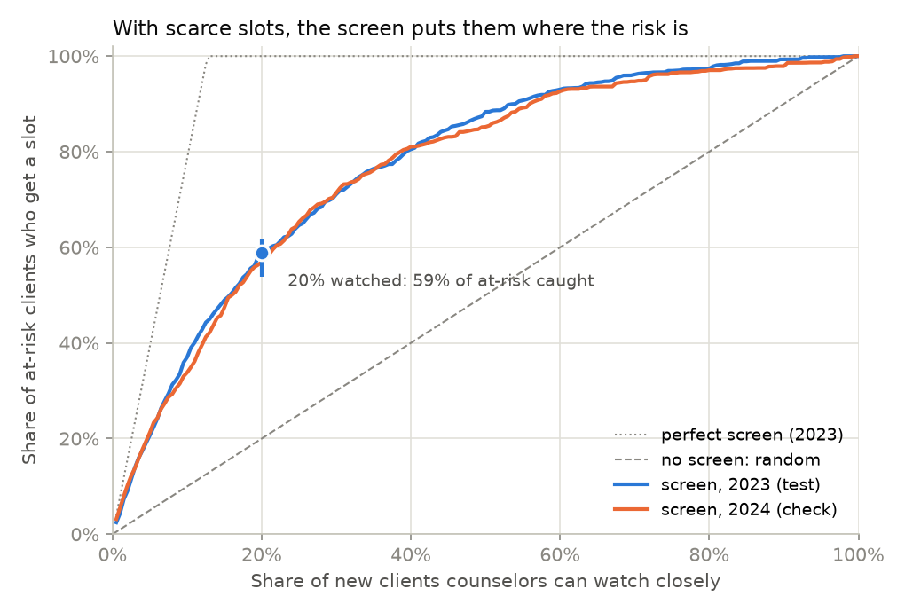

## Action

**Give counselors the six K6 distress questions at intake and a list of new clients sorted by score. The close-monitoring slots go to the highest scores.**

The counselor decides. A client with active intent goes to emergency services first, not into the list.

Counselor time is the constraint: 46% of psychologists have no openings for new patients, and 40% have a waitlist (APA, 2025).

A model with four more intake answers did not clearly beat K6 alone, so the list is sorted by K6.

Next step: each practice's own capacity, and a legal read on whether a sorted list stays outside FDA device rules.

## Reason

{width="52%" fig-align="center"}

If counselors can watch **1 in 5** new clients, sorting by K6 gives a slot to **56% of at-risk clients** (95% interval 52.7–59.5%), against 20% at random: **7.1 at-risk clients per 100 new clients, against 2.5**. Held-out 2023; 2024 gives 55%.

The five-answer model reaches 59%. The gain, 2.7 points, has an interval of −0.9 to 3.9.

## Risk

At 20% capacity, **44% of at-risk clients still start on standard monitoring: 5.6 in every 100 new clients.**

At-risk clients aged 65 and over are the least likely to get a slot: 40% in 2023 and 22% in 2024, against 66% and 62% at ages 18–25. The screen predicts thoughts of suicide, not attempts or deaths.

It is one score at intake. It cannot see a client getting worse, and a client who under-reports scores low.

If counselors could watch everyone, a screen clearly pays only while a missed at-risk client costs up to 29 weeks of monitoring. From 50, the data cannot tell.

## Value

A perfect screen would give every at-risk client a slot once 13% of clients can be watched. K6 reaches 56% at 20%.

**Better predictors are worth up to 5.6 more at-risk clients on close monitoring per 100 new clients.** More capacity is worth 1.8 per 100 for each extra 10% watched (20% to 30%).

Four more survey answers added 2.7 points in 2023 and 1.6 in 2024, which the data cannot tell from zero. Better answers are worth more, such as a client's first-week conversations in FirstHarbor.
