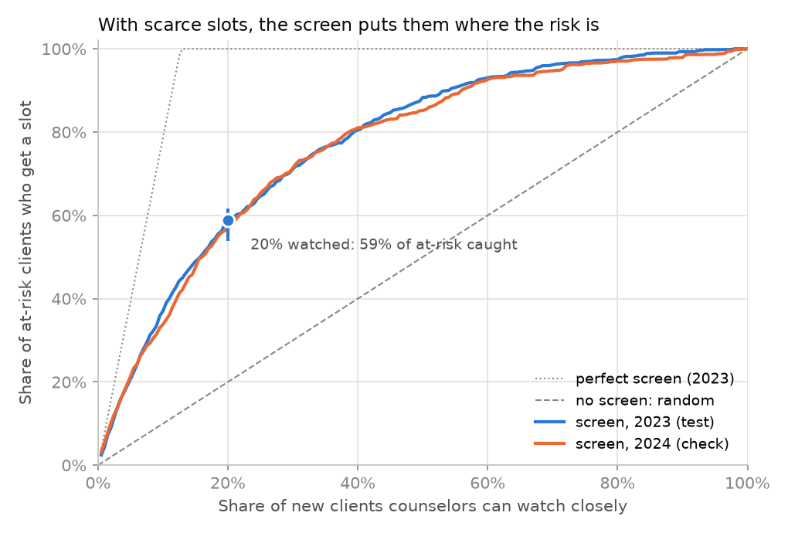

## Action

**Build intake screening, and give the close-monitoring slots to the new clients with the highest predicted risk.**

Counselor time is the constraint: 46% of psychologists have no openings for new patients, and 40% have a waitlist (APA, 2025).

Five intake answers drive the ranking: age, distress (K6), substance use disorder, psychiatric medication, and phone or video treatment.

Next step: ask counselors what share of new clients they can watch closely in week 1.

## Reason

{width="55%" fig-align="center"}

If counselors can watch **1 in 5** new clients, the screen gives a slot to **59% of at-risk clients** (95% interval 54–62%), against 20% at random. That is **7.5 at-risk clients per 100 new clients, against 2.5**. Held-out 2023; the 2024 check gives 57%.

## Risk

At 20% capacity, **41% of at-risk clients still start on standard monitoring: about 5 in every 100 new clients.**

The screen ranks risk. It does not create counselor time.

If time were unlimited, screening would beat watching everyone only when a missed at-risk client costs 30 weeks of monitoring or less.

## Value

A perfect screen would give every at-risk client a slot once 13% of clients can be watched. This one reaches 59% at 20%.

**Better predictors are worth up to 5 more at-risk clients on close monitoring per 100 new clients.** More capacity is worth 1.6 per 100 for each extra 10% watched (20% to 30%).

More of the same survey data is worth little. Better answers are worth more, such as a client's first-week conversations in FirstHarbor.
